<p align="center">
  
</p>

```text
$ cat stack/*
```

`frontend`        

`mobile`    

`backend`       

`design`      

`tools`   

<p align="center">
  
</p>

<picture>
  <source media="(prefers-color-scheme: dark)" srcset="https://raw.githubusercontent.com/housesaroma/housesaroma/output/github-snake-dark.svg" />
  <source media="(prefers-color-scheme: light)" srcset="https://raw.githubusercontent.com/housesaroma/housesaroma/output/github-snake.svg" />
  
</picture>
